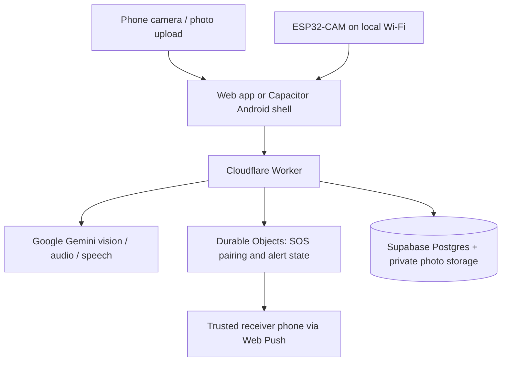

# Daredevil's Eye

**A Bangla-first, voice-guided assistive vision prototype for blind and low-vision people.** Point a phone or ESP32-CAM at a scene, ask a question, and hear an AI-generated description in Bangla or English.

<p align="left">
  <a href="https://daredevils-eye.karanjoykundu.workers.dev/"></a>
  <a href="https://github.com/KaranJoyKundu/Daredevil-s-Eye/actions"></a>
  <a href="https://github.com/KaranJoyKundu/Daredevil-s-Eye/blob/main/SECURITY.md"></a>
</p>

> **Important safety note:** This is an experimental assistive tool, not a certified mobility aid, medical device, or emergency service. AI can misread scenes, labels, medicine and money. Never rely on it to decide whether a road crossing or path is safe. Continue using a white cane, guide dog, mobility training and human assistance.

---

## Start here

| I want to… | Go to |
|---|---|
| Try the live app | [Open Daredevil's Eye](https://daredevils-eye.karanjoykundu.workers.dev/) |
| Use the simplified blind-first interface | [Blind mode](https://daredevils-eye.karanjoykundu.workers.dev/blind/) |
| Read the current project status | [Implementation status](docs/STATUS.md) |
| Install and run the project locally | [Setup guide](docs/SETUP.md) |
| Understand the system | [Architecture](docs/ARCHITECTURE.md) |
| Find a guide for a specific task | [Documentation hub](docs/README.md) |
| See what is verified and what still needs testing | [Release checklist](docs/CURRENT-RELEASE-CHECKLIST.md) |
| Report a security issue | [Security policy](SECURITY.md) |

**Live services:** [Website](https://daredevils-eye.karanjoykundu.workers.dev/) · [Action app](https://daredevils-eye.karanjoykundu.workers.dev/action/) · [Blind mode](https://daredevils-eye.karanjoykundu.workers.dev/blind/) · [Project documentation](https://daredevils-eye.karanjoykundu.workers.dev/documentation/)

## Download the Android app

<a href="https://appdistribution.firebase.google.com/testerapps/1:196832423983:android:5398d21c07fd260c21d6da/releases/5u4gh86a181lo?utm_source=firebase-console">Download Daredevil's Eye for Android via Firebase App Distribution</a>

This is the current Firebase App Distribution tester release. Open the link on your Android device, sign in with the Google account that has been invited to the tester distribution, and follow Firebase's install prompts. If Firebase reports that access is unavailable, ask the project owner to add your Google account as a tester. This is a tester distribution link, not a public Play Store listing or a permanent signed-release download.

## What it does

Daredevil's Eye connects a camera, a phone-friendly interface, speech input/output and Google's Gemini models. The Cloudflare Worker handles the server-side API; optional account/guest photo history uses Supabase; SOS pairing and alert state use Cloudflare Durable Objects.

| Capability | Current project behaviour |
|---|---|
| **Describe** | Captures or accepts a photo and asks the vision model to describe the scene, visible text and relevant hazards. |
| **Ask AI** | Records a short spoken question, transcribes it, and answers using the selected image. Bangla, English and mixed-language input are intended. |
| **Bangla / English** | Bangla (Bangladesh) is the default; the language switch changes interface and speech preferences. |
| **Voice feedback** | Uses device speech synthesis where available. A Gemini speech fallback is used for Bangla on desktops without a suitable Bengali voice. |
| **Blind mode** | Four large primary actions — Describe, Ask AI, SOS and Repeat — plus separate Spoken Help, haptic feedback and accessible status announcements. |
| **Phone camera and uploads** | Supports phone capture and photo selection, with client-side JPEG compression before analysis. |
| **ESP32-CAM** | Supports a local-network camera preview/stream and still-image capture. The phone and camera must be able to reach one another on the LAN. |
| **Assistant presets** | Admin offers All-in-one, Single object, Medicine, Read text, Taka, Colour and Custom prompt modes. Server-side safety instructions remain in force. |
| **SOS pairing** | A sender can pair a trusted receiver and send a confirmation-based alert through the Worker and Web Push. Delivery is best-effort, not guaranteed. |
| **Account and photo history** | Optional signed-in and guest history uses private Supabase storage. Guest records are scheduled for deletion after 30 days. Verify the live flow before relying on retention behaviour. |
| **Installable web app** | Android Chrome can install the web app and expose supported home-screen shortcuts. |
| **Native Android companion** | Capacitor/native Android source and a CI-built debug APK are in the repository. Galaxy A55 physical validation and a persistent signed release remain separate tasks. |
| **Model fallback** | The Worker can try other compatible Gemini models for model-specific availability or quota errors. It cannot bypass a project-wide Google quota. |

### Physical volume-button mapping (native Android plan)

| Input | Intended action |
|---|---|
| Volume Up | Describe |
| Volume Down | Ask AI |
| Double Volume Up | Repeat the last answer |
| Hold Volume Up + Volume Down | Open the SOS confirmation flow; holding the keys alone must not dispatch an alert |

The native implementation is present in the repository, but the mapping, global Accessibility Service, TalkBack coexistence and screen-off behaviour must be validated on the target Galaxy A55 before being described as reliable. Android may restrict camera/microphone work while locked or in the background.

## Pages

| Route | Purpose |
|---|---|
| `/` | Project landing page and About |
| `/action/` | Main task interface: Describe, Ask AI, camera and uploads |
| `/blind/` | Blind-first four-action interface |\n| `/devices/` | Android shortcut settings and hardware setup entry points |
| `/sos/` | Canonical SOS Center: sender, receiver, pairing and acknowledgement |
| `/medicine/` | Medicine identification and RFID-assisted workflow |
| `/admin/` | App and device configuration only |
| `/diagnostics/` | Camera, microphone, speaker, AI and backend health checks |
| `/account/` | Sign-in and optional photo history |
| `/documentation/` | Documentation index and structured reference |
| `/help/` | Task-oriented user help |
| `/privacy/`, `/terms/` | Privacy notice and terms |
| `/support/`, `/contact/` | Support and contact |
| `/sos-receiver/` | Legacy compatibility route; use canonical `/sos/` |

## How it works



- **Web client:** plain HTML, CSS and JavaScript under `web/`; there is no front-end bundler requirement for the web app.
- **Worker:** `worker/src/index.js` serves static assets and same-origin API routes. Prompt assembly and safety rules are in `worker/src/prompts.js`.
- **Native Android:** Capacitor hosts the existing app; native Android code handles the platform-specific volume-key and Accessibility Service integration.
- **State and storage:** Durable Objects coordinate SOS state. Supabase stores optional account/guest history in a private bucket.
- **Secrets:** Gemini and Supabase service credentials belong in Worker/GitHub secrets, never in browser code, committed files or APK assets.

For detailed data flows and trust boundaries, see [Architecture](docs/ARCHITECTURE.md) and [Threat model](docs/THREAT-MODEL.md).

## Run locally

### Requirements

- Node.js 24 (or the repository-supported current runtime)
- npm
- A Gemini API key for live AI requests
- Optional: ESP32-CAM and a phone/PC on the same local network for camera testing

### Windows PowerShell

```powershell
git clone https://github.com/KaranJoyKundu/Daredevil-s-Eye.git
cd Daredevil-s-Eye
npm install
Copy-Item .dev.vars.example .dev.vars
```

Put your own `GEMINI_API_KEY` in `.dev.vars`. Never commit this file or paste secrets into source code.

Run the checks and start the Worker:

```powershell
npm test
npm run check
npx wrangler dev --ip 0.0.0.0 --port 8791
```

Open the local URL printed by Wrangler (normally `http://localhost:8791`). Microphone access on a phone requires HTTPS; use the deployed HTTPS site or a secure development tunnel. Full instructions: [Local setup](docs/SETUP.md).

## Testing and evidence

Use the exact commit's GitHub Actions result when checking CI. A passing unit/syntax workflow does not prove a physical phone, camera, microphone, speech engine or SOS receiver works.

```powershell
npm test
npm run check
```

Then follow the [manual test matrix](docs/TESTING.md) and [current release checklist](docs/CURRENT-RELEASE-CHECKLIST.md). Record the device model, Android/One UI version, browser, test date and result. Keep **implemented in source**, **automated-tested**, **browser-tested** and **physically verified** as separate evidence levels.

## Deployment

The production app is served by Cloudflare Workers with Static Assets and Durable Objects. GitHub Actions verifies pull requests; a successful push to `main` runs the production deployment workflow when its required secrets are configured.

1. Work on a feature/documentation branch.
2. Open a pull request against `main`.
3. Review the diff and checks on the exact PR head commit.
4. Merge only after review.
5. Confirm the main-branch deployment succeeds.
6. Smoke-test the live routes and critical user flows.

See [Deployment](docs/DEPLOYMENT.md). Documentation-only commits also trigger the current main deployment workflow; do not assume a green PR check means production has updated.

## Privacy, safety and security

- The app's visible privacy notice explains that submitted images and voice input are sent to Google services for processing. Do not submit confidential material.
- The requested privacy experience is informational: no blocking consent popup, Accept button, checkbox or photo-history opt-in toggle.
- Photo history is optional and stored privately when enabled by the relevant account/guest flow. Guest history has a 30-day retention policy in the Worker.
- The project does not intentionally retain raw microphone recordings for the photo-history feature. Provider processing and provider terms still apply.
- A personal Gemini key entered in Admin is held in the current browser tab's session storage and sent only to relevant same-origin Worker endpoints. Signed-in users can separately save an encrypted account key through Account & History; the Worker decrypts it only for provider requests.
- The ESP32-CAM local HTTP endpoint may be unauthenticated. Keep it on a trusted LAN; never expose it directly to the public Internet.
- SOS alerts a paired trusted receiver; it does not contact emergency services, and delivery is not guaranteed.
- AI may hallucinate, misread text or fail to detect hazards. Confirm medicine, money, labels and safety-critical information with a person or trusted source.

Read [Safety and privacy](docs/SAFETY.md), [Security policy](SECURITY.md) and [Threat model](docs/THREAT-MODEL.md).

## Documentation map

The [documentation hub](docs/README.md) is the navigation index. The [feature map](docs/FEATURE-MAP.md) defines canonical ownership; [decisions](docs/DECISIONS.md) record durable rationale. Key references:

| Document | What it covers |
|---|---|
| [Feature map](docs/FEATURE-MAP.md) | Complete feature inventory and canonical page ownership |\n| [Decisions](docs/DECISIONS.md) | Product/architecture decisions and rationale |\n| [Status](docs/STATUS.md) | Current verified state, recent incidents and outstanding validation |
| [Architecture](docs/ARCHITECTURE.md) | Components, routes, data flows, AI, storage and SOS |
| [Setup](docs/SETUP.md) | Local development, camera, voice, BYOK and web install |
| [Deployment](docs/DEPLOYMENT.md) | Cloudflare configuration, secrets, CI and release procedure |
| [Testing](docs/TESTING.md) | Automated commands and manual acceptance matrix |
| [Accessibility](docs/ACCESSIBILITY.md) | Blind mode, speech, assistive technology and evaluation |
| [Phone controls](docs/PHONE-CONTROLS.md) | Web shortcuts, Android hardware keys and limitations |
| [Native Android app](docs/NATIVE-ANDROID-APP.md) | Capacitor architecture, button mapping, phases and A55 validation |
| [Android release signing](docs/ANDROID-RELEASE-SETUP.md) | Owner-controlled keystore and signed APK workflow |
| [Current release checklist](docs/CURRENT-RELEASE-CHECKLIST.md) | Evidence-based release gates |
| [Roadmap](docs/ROADMAP.md) | Product phases and future work |
| [Changelog](CHANGELOG.md) | User-visible project changes |
| [Supabase setup](docs/SUPABASE-ACCOUNT-HISTORY-SETUP.md) | Account and private photo-history setup |
| [Implementation plan](docs/IMPLEMENTATION-PLAN.md) | Historical implementation plan |
| [Camera and emergency roadmap](docs/NEXT-GENERATION-CAMERA-AND-EMERGENCY-ROADMAP.md) | Proposed camera and emergency features |
| [Security](SECURITY.md) | Vulnerability reporting |

## Project principles

1. **Blind-first:** primary actions must be understandable without relying on sight.
2. **Bangla-first:** Bangla is the default, while English remains available.
3. **Fail visibly and honestly:** never imply an action succeeded when the Worker/device did not confirm it.
4. **Privacy by design:** disclose processing, minimise retention and keep secrets server-side.
5. **Safety over convenience:** confirmation before SOS dispatch; no unsupported navigation or emergency guarantees.
6. **Evidence before checkmarks:** source code, CI, browser checks and physical-device tests are different levels of proof.

---

Maintained in [KaranJoyKundu/Daredevil-s-Eye](https://github.com/KaranJoyKundu/Daredevil-s-Eye). For a task-oriented entry point, start at [docs/README.md](docs/README.md).
