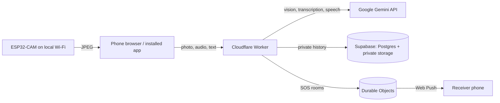

# Daredevil's Eye

**A Bangla-first camera assistant for blind and low-vision people. Point a camera, tap once, and hear what is in front of you.**

[](https://daredevils-eye.karanjoykundu.workers.dev/)


Daredevil's Eye takes a photo from a phone or an ESP32-CAM, sends it to Google Gemini, and reads the answer aloud in Bangla or English. Four large buttons cover the main tasks: describe the scene, ask a spoken question, repeat the last answer, and alert a trusted person (SOS). The app runs in the phone browser and can be installed to the home screen. Nothing needs to be downloaded from an app store.

**Live demo:** https://daredevils-eye.karanjoykundu.workers.dev/

> Daredevil's Eye is an experimental prototype. It is not a certified navigation aid, medical device or emergency service. Keep using a white cane, a guide dog and human help.

## Try it in two minutes

1. Open the [live demo](https://daredevils-eye.karanjoykundu.workers.dev/) on a phone in Chrome. The home page explains the project. Tap **Try the live app**.
2. Accept the terms once. Choose **English** or **বাংলা** with the language switch at the top. Bangla is the default.
3. Tap **Describe**. Take or upload a photo, then confirm. The answer appears on screen and is read aloud.
4. Tap **Ask AI** and speak a question in Bangla, English or a mix of both, for example "What is written on this box?"
5. Open **Blind mode** (`/blind/`) for the screen built for blind users: four full-screen tiles and no menus.
6. Optional: in **Admin → AI**, pick an assistant mode such as *Medicine*, *Taka* or *Text*, or write your own instructions.

## Features

| Area | What it does |
|---|---|
| Describe | Describes the scene: the main objects, any text and possible hazards, without guessing distances. |
| Ask AI | You speak a question. Gemini writes it down and then answers it using the photo. Works with Bangla, English and mixed speech. |
| Bangla and English | An English / বাংলা switch changes the whole interface, every spoken message and the AI's answers. |
| Voice output | Uses the phone's own voice. On computers with no Bengali voice installed (for example Windows), Bangla is spoken by a Gemini cloud voice instead. |
| Assistant modes | In Admin, pick a preset: All-in-one, Single object, Medicine, Read text, Taka (banknotes) or Colour. You can also write your own instructions, up to 4,000 characters. The built-in safety rules are always added. |
| Camera | Phone camera or photo upload, with a preview before sending. The ESP32-CAM takes up to three frames and keeps the sharpest. Photos are shrunk to a JPEG under 4 MB on the device. A single shutter click plays when a photo is taken. |
| Blind mode | Four large tiles (Describe, Ask AI, SOS, Repeat), spoken help, vibration patterns and a screen that stays on while working. |
| SOS | Alerts a trusted person on a paired second phone through a web push notification. SOS needs two taps to confirm. Shake SOS and voice-phrase SOS are optional and off by default. |
| History | Optional private photo-and-answer history: kept for signed-in users until they delete it; guest history is deleted after 30 days. |
| Installable app | Can be installed from Chrome as a home-screen app, with long-press shortcuts for Describe, Ask AI and SOS. |
| Model fallback | Uses Gemini 3.8 Flash by default. If a model hits a quota or is unavailable, it tries other Gemini vision models. |

## Pages

| Path | Purpose |
|---|---|
| `/` | Project landing page for visitors and judges |
| `/action/` | Main app: Describe, Ask AI, SOS, Help, phone camera and upload |
| `/blind/` | Blind mode: four large tiles and spoken help |
| `/admin/` | Settings: camera, SOS pairing, AI model, assistant mode and prompt, voice, history |
| `/diagnostics/` | Phone, camera, microphone, speaker, AI and backend checks |
| `/account/` | Sign in, private photo history, personal Gemini key, usage |
| `/sos-receiver/` | Pair the trusted person's phone and receive alerts |
| `/help/`, `/terms/`, `/privacy/`, `/support/`, `/contact/` | Help, terms, privacy notice, support and contact pages |

## How it works



- **Front end:** plain HTML, CSS and JavaScript in `web/`, with no build step. Bangla interface text is in `web/shared/bn-text.js`.
- **Back end:** one Cloudflare Worker (`worker/src/index.js`). It serves the static pages and the `/api/*` routes: describe, ask, transcribe, speech, models, SOS, account and guest history. AI instructions are in `worker/src/prompts.js`.
- **Secrets:** the Gemini key stays a Worker secret and is never sent to the browser. Users can bring their own key (BYOK). It is kept only for the current tab, or stored encrypted for signed-in users.

More detail: [Architecture](docs/ARCHITECTURE.md).

## Run it locally (Windows PowerShell)

Requirements: Node.js 24, npm and a Gemini API key.

```powershell
git clone https://github.com/KaranJoyKundu/Daredevil-s-Eye.git
cd Daredevil-s-Eye
npm install
Copy-Item .dev.vars.example .dev.vars   # then put GEMINI_API_KEY=... in .dev.vars (never commit it)
npm test                                # 80 Node tests
npm run check                           # syntax check of Worker and browser modules
npx wrangler dev --ip 0.0.0.0 --port 8791
```

Open `http://localhost:8791`. A phone needs HTTPS to use the microphone, so use the live site or a tunnel to test on a phone. See [Setup](docs/SETUP.md).

## Deployment

A merge to `main` runs the tests and then deploys the Worker to Cloudflare with GitHub Actions. Pull requests run tests only. See [Deployment](docs/DEPLOYMENT.md).

## Privacy and limits

- Photos, short voice clips and text sent for speech are processed by Google Gemini. Avoid sending anything confidential.
- Photo history is stored only when history is turned on, in a private storage bucket. Raw IP addresses are never stored.
- Answers can be wrong. The app never claims a path or road crossing is safe, and never makes up distances.
- SOS is a best-effort alert to one paired phone. It does not call emergency services, and delivery is not guaranteed.
- Android Chrome does not pass the hardware volume buttons to web pages. Volume-button control needs MacroDroid/Tasker or a future native app. See [Phone controls](docs/PHONE-CONTROLS.md).

Details: [Safety](docs/SAFETY.md), [Security policy](SECURITY.md), [Threat model](docs/THREAT-MODEL.md).

## What has been checked

- **Automated:** all 80 tests and the syntax check pass, both locally and in CI.
- **In a browser:** the live site was checked at desktop, tablet and mobile sizes, and with the Bangla and English interface.
- **Still to test on real hardware:** Bangla speech on the Galaxy A55, the shutter sound on a phone, SOS with the screen off on a second phone, the full ESP32-CAM flow, and testing with blind users. See the [release checklist](docs/CURRENT-RELEASE-CHECKLIST.md).

## Documentation

| Document | Contents |
|---|---|
| [Current release checklist](docs/CURRENT-RELEASE-CHECKLIST.md) | What is done and what still needs testing on real devices |
| [Status](docs/STATUS.md) | Production state and deployment record |
| [Architecture](docs/ARCHITECTURE.md) | Routes, data flows, model fallback, SOS and history |
| [Setup](docs/SETUP.md) / [Deployment](docs/DEPLOYMENT.md) | Local development, secrets and release flow |
| [Testing](docs/TESTING.md) | Automated tests and manual acceptance matrix |
| [Accessibility](docs/ACCESSIBILITY.md) / [Phone controls](docs/PHONE-CONTROLS.md) | Blind mode, voice and Android integrations |
| [Safety](docs/SAFETY.md) / [Threat model](docs/THREAT-MODEL.md) / [Security](SECURITY.md) | Safety boundaries, risks and how to report a vulnerability |
| [Supabase setup](docs/SUPABASE-ACCOUNT-HISTORY-SETUP.md) | Account and photo-history backend |
| [Roadmap](docs/ROADMAP.md) / [Changelog](CHANGELOG.md) | What is planned next and what has changed |
| [Implementation plan](docs/IMPLEMENTATION-PLAN.md) | The 17 November work plan, kept as a record |

